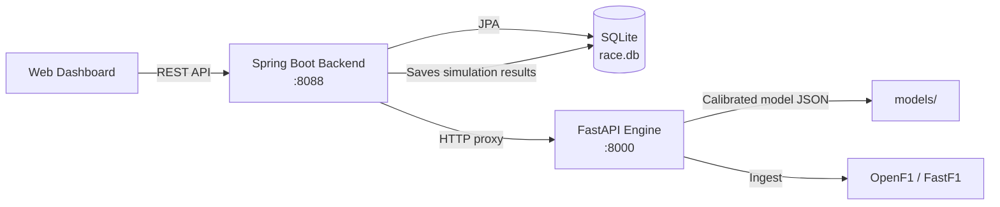

# F1 Race Strategy Decision System

<p align="center">
  <strong>A Three-Tier Decision-Support System for Formula 1 Pit Strategy: Calibration, Simulation, and Recommendation</strong>
</p>

<p align="center">
  <a href="#overview">Overview</a> •
  <a href="#objectives">Objectives</a> •
  <a href="#methodology">Methodology</a> •
  <a href="#architecture">Architecture</a> •
  <a href="#rest-api">REST API</a> •
  <a href="#installation">Installation</a> •
  <a href="#usage">Usage</a> •
  <a href="#limitations">Limitations</a>
</p>

<p align="center">
  
  
  
  
  
  
  
</p>

<!-- Add a screenshot after your first run: save it as docs/dashboard.png, then uncomment the block below.
<p align="center">
  
</p>
-->

---

## Overview

This project is a decision-support application for **Formula 1 pit strategy**. It models how lap time evolves with tyre compound, tyre age, and fuel load, calibrates that model on real race data, and uses it to search, simulate, and recommend pit plans.

The system is built as three cooperating tiers:

* **Python strategy engine (FastAPI)** — calibration, strategy search, analysis, simulation, and machine learning
* **Spring Boot backend** — REST API, SQLite persistence, and a proxy to the engine
* **Web dashboard** — a dark single-page interface for importing, analyzing, simulating, comparing, and dueling strategies

All three tiers communicate through a small, consistent contract: times are integer milliseconds, compounds are `SOFT | MEDIUM | HARD | INTERMEDIATE | WET`, `race_id` is `{year}-{round}`, and `driver_id` is the lowercase three-letter driver code.

---

## Research Question

How can a lap-time model calibrated on real race data be used to rank pit-stop strategies, simulate full races, and recommend the next pit decision under changing conditions such as tyre wear and rain?

---

## Objectives

This project aims to:

* Model lap time as a function of compound, tyre age, and fuel load, including a degradation cliff.
* Calibrate the model per race, with per-driver pace offsets and a per-compound cliff.
* Search and rank 1, 2, and 3-stop strategies.
* Analyze a driver's real laps: pace, stints, pit stops, and fuel effect.
* Simulate a full 20-car race for any pit plan.
* Recommend the next pit lap and compound with a confidence score.
* Evaluate undercut and overcut scenarios against a rival's actual plan.
* Predict upcoming lap times with machine learning models.
* Provide a reproducible workflow from raw race data to a strategy decision.

---

## Methodology

### 1. Data Ingestion

Race data can be loaded in three ways:

1. **OpenF1** — real races, no authentication required
2. **FastF1** — real races through the FastF1 library
3. **Offline demo race** — a generated race that includes a rain phase

Laps are cleaned before modeling by removing outliers such as pit laps and safety car laps.

---

### 2. Lap-Time Model and Calibration

Lap time is modeled as a function of three factors:

| Factor | Role |
| ------ | ---- |
| Tyre compound | Base pace and degradation behavior |
| Tyre age | Degradation, including a cliff after which pace drops sharply |
| Fuel load | Lap time improves as the car gets lighter |

Calibration is performed **per race** using least squares, with:

* per-driver pace offsets
* a **grid-searched degradation cliff** for each compound

The calibrated model is stored as JSON for each race.

---

### 3. Strategy Search

The engine enumerates pit plans with one, two, or three stops, subject to two constraints:

* at least **two different compounds** per plan
* a **minimum stint length**

Each plan is ranked by total race time, reported as a delta against the best plan, together with degradation curves for comparison.

---

### 4. Race Simulation

The simulator runs a full **20-car race** for any pit plan and accounts for:

* tyre degradation
* fuel load
* pit-stop overhead
* dirty air
* rain

The simulation is **deterministic for a fixed seed**, which makes results reproducible.

---

### 5. Recommendation and Duel

The recommendation module suggests the **next pit lap and compound** together with a confidence score.

It is rain-aware:

* `INTERMEDIATE` is recommended on any rain ahead
* `WET` is recommended from 2.5 mm
* wet pit stops are modeled as slower

The **duel** module evaluates undercut and overcut options against a rival's actual plan.

---

### 6. Machine Learning

The next 10 laps are predicted with three regressors:

* Linear Regression
* Random Forest
* Gradient Boosting

---

## Architecture

```text
browser  ──►  Spring Boot :8088  ──►  FastAPI engine :8000
   UI            /api/** proxy,          analysis, simulation,
 (static/        SQLite persistence      ML, strategy search,
  app ui)        (strategies table)      calibration, ingest
```

### System Pipeline

```text
┌──────────────────────┐
│   Race Data Source   │
│ OpenF1 / FastF1 / Demo│
└──────────┬───────────┘
           │
           ▼
┌──────────────────────┐
│  Cleaning & Ingest   │
│  Outlier Removal     │
└──────────┬───────────┘
           │
           ▼
┌──────────────────────┐
│ Per-Race Calibration │
│ Least Squares + Cliff│
└──────────┬───────────┘
           │
┌──────────┼────┬───────────┐
▼         ▼     ▼           ▼
Strategy Race   Pit    ML Lap-Time
Search   Sim Recommend Prediction
│          │     │          │
└──────────┼─────┴──────────┘
           │
           ▼
┌──────────────────────┐
│  Spring Boot + SQLite│
└──────────┬───────────┘
           │
           ▼
┌──────────────────────┐
│   Web Dashboard      │
└──────────────────────┘
```

### Data Flow


---

## Dataset

Race data is stored in SQLite (`database/race.db`, gitignored) following `database/schema.sql`. The schema holds:

* `drivers`
* `races`
* `laps` — lap time, sectors, compound, tyre age, track status, pit flag, fuel, position
* `pit_stops`
* `strategies` — saved simulation results

An offline demo race can be generated at any time with `scripts/create_demo_db.py`.

---

## Project Structure

```text
F1-Race-Strategy-Decision-System/
│
├── src/f1_strategy/        # Python engine
│   ├── strategy.py         # Strategy search
│   ├── calibrate.py        # Calibrated core
│   ├── racecalib.py        # Per-race calibration
│   ├── simulator.py        # 20-car race simulator
│   ├── recommend.py        # Pit recommendation & duel
│   ├── analysis.py         # Driver analysis
│   ├── ml.py               # Lap-time prediction
│   ├── data.py, db.py      # Data access
│   ├── ingest.py           # FastF1 ingest
│   ├── openf1_ingest.py    # OpenF1 ingest
│   └── api/                # FastAPI app (port 8000)
│
├── backend/                # Spring Boot backend (port 8088)
│   └── src/main/resources/static/   # Web dashboard UI
│
├── database/               # schema.sql (+ race.db, gitignored)
├── models/                 # Per-race calibrated model JSON
├── dashboard/              # Static single-file offline report
├── scripts/                # calibrate, export, run_engine, create_demo_db
├── tests/                  # pytest suite (engine + API)
└── README.md
```

---

## REST API

The Spring Boot backend owns SQLite, serves the dashboard, and proxies analysis, simulation, and ML calls to the Python engine.

| Method | Path | Source |
| ------ | ---- | ------ |
| GET | `/api/drivers` | SQLite (JPA) |
| GET | `/api/races` | SQLite (JPA) |
| GET | `/api/races/{raceId}/drivers` | SQLite (JPA) |
| GET | `/api/races/{raceId}/laps/{driverId}` | SQLite (JPA) |
| GET | `/api/engine/health` | Python `/health` |
| POST | `/api/ingest` | Python `/ingest` |
| GET | `/api/analyze/{raceId}/{driverId}` | Python `/analyze` |
| POST | `/api/predict` | Python `/predict` |
| POST | `/api/simulate` | Python `/simulate` + saves result into `strategies` |
| POST | `/api/strategy/recommend` | Python `/strategy/recommend` |
| POST | `/api/strategy/duel` | Python `/strategy/duel` |
| POST | `/api/strategy/search` | Python `/strategy/search` |
| POST | `/api/calibrate/{raceId}` | Python `/calibrate/{raceId}` |

Backend configuration:

| Key | Default | Meaning |
| --- | ------- | ------- |
| `f1.db.path` | `../database/race.db` | SQLite file |
| `python.engine.url` | `http://localhost:8000` | Python engine base URL |
| `server.port` | `8088` | HTTP port |

---

## Installation

Prerequisites: **Python 3**, **Java 17+**, and **Maven**.

Clone the repository:

```bash
git clone https://github.com/ArianShayestehfard/F1-Race-Strategy-Decision-System.git
```

Navigate to the project directory:

```bash
cd F1-Race-Strategy-Decision-System
```

Create a virtual environment:

```bash
python -m venv .venv
```

Activate the virtual environment on Windows:

```powershell
.venv\Scripts\activate
```

Install the required dependencies:

```bash
pip install -r requirements.txt
```

---

## Usage

### Run with IntelliJ

The included run configurations cover everything. **0 - ALL SERVICES** starts the engine, the backend, and the dashboard in one go.

### Run Manually

Create the offline demo race:

```bash
python scripts/create_demo_db.py
```

Start the Python engine on port 8000:

```bash
python scripts/run_engine.py
```

Start the Spring Boot backend on port 8088:

```bash
cd backend
mvn spring-boot:run
```

Open the dashboard at `http://localhost:8088/`.

### Offline Static Report

No services are required for this workflow:

```bash
python scripts/calibrate.py --year 2024 --gp Bahrain
python scripts/export_dashboard_data.py --model models/bahrain_2024.json --laps 57 --race "Bahrain 2024"
```

Then open `dashboard/index.html` in a browser.

### Run the Tests

```bash
pytest            # engine and API tests
cd backend
mvn test          # backend tests (the engine client is mocked, Python not required)
```

---

## Roadmap

- [x] Data pipeline: load race laps and clean outliers (pit laps, safety cars)
- [x] Fit per-compound degradation models from real data
- [x] Strategy comparison dashboard (1/2/3-stop plans and degradation curves)
- [x] Driver analysis, 20-car simulator, rain-aware recommendation, rival duel
- [x] ML lap-time prediction (3 models) and JSON report export
- [ ] Validate calibrated models against actual race strategies
- [ ] Live lap-by-lap recommendations during a session

---

## Limitations

This project is an experimental decision-support tool and should not be interpreted as a source of real race-engineering decisions.

The main limitations include:

* Calibrated models have not yet been validated against the strategies teams actually ran.
* Recommendations are computed on historical or demo data, not on a live session.
* The offline demo race is generated data, intended for demonstration and testing rather than analysis.
* The simulator is a simplified model of a race and does not cover every factor that affects real race outcomes.
* Calibration quality depends on the amount and quality of the laps available for each race.
* Results may vary depending on the installed versions of Python libraries.

---

## Technologies

* Python
* FastAPI
* NumPy
* Pandas
* Scikit-learn
* FastF1
* OpenF1
* Java
* Spring Boot
* SQLite
* JavaScript, HTML, CSS

---

## Author

</div>
<p align="center">
  <b>Arian Shayestehfard</b>
  <br>
  Computer Engineering Student
  <br><br>
  <a href="https://github.com/ArianShayestehfard">
    
  </a>
</p>


---

## License

This project is licensed under the MIT License. See [LICENSE](LICENSE) for details.
