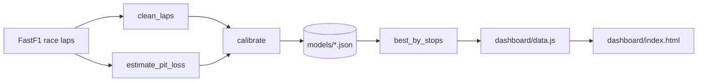

# F1 Race Strategy Decision System

Compare Formula 1 pit-stop strategies with a tyre degradation model calibrated from real race data, and review the recommendation in a clean browser dashboard.

<!-- Add a screenshot after your first run: save it as docs/dashboard.png, then uncomment the line below. -->
<!--  -->

## Overview

Choosing when to pit and which tyres to fit is one of the biggest levers a team has during a race. This project answers a focused question:

> Given a race length and how the tyres behave at this track, which 1, 2 or 3 stop strategy is fastest, and by how much?

It does this in three steps: load and clean real lap data, fit a transparent tyre model to it, then search every valid strategy and show the results.

## Features

- **Real data pipeline.** Downloads race laps with [FastF1](https://docs.fastf1.dev/) and keeps only representative laps: no lap 1, no in/out laps, no safety car or yellow-flag laps, no wet tyres, no slow outliers.
- **Calibrated tyre model.** Fits per-compound pace offset, wear rate and degradation cliff, plus the fuel-burn effect and per-driver pace, by least squares.
- **Measured pit loss.** Estimates time lost per stop from the real in-lap and out-lap pairs.
- **Strategy search.** Finds the fastest plan for 1, 2 and 3 stops, requiring at least two different compounds and a minimum stint length.
- **Dashboard.** Static HTML page to compare options, see the stint layout and inspect degradation curves. No server needed.
- **Tested.** The model, the cleaning rules and the calibration (recovering known parameters from synthetic races) are covered by pytest.

## How it works



### The lap time model

```
lap_time = base_lap + offset[c] + wear[c] * age + cliff[c] * max(age - cliff_age[c], 0) - fuel_gain * lap
```

| Parameter | Meaning |
|---|---|
| `base_lap` | Reference lap time on fresh tyres of the fastest compound, with no fuel effect (s) |
| `offset[c]` | Pace difference of compound `c` versus the fastest compound (s) |
| `wear[c]` | Linear degradation per lap of tyre age (s/lap) |
| `cliff_age[c]`, `cliff[c]` | Tyre age after which degradation accelerates, and the extra seconds lost per lap beyond it |
| `fuel_gain` | Seconds gained per lap as the car burns fuel (s/lap) |
| `pit_loss` | Time lost per pit stop (s) |

A strategy's race time is the sum of its stint times plus `pit_loss` for every stop.

### The search

For each stop count (1 to 3), the search tries every combination of pit laps (step of 2 laps, minimum stint of 8 laps) and every compound sequence that uses at least two different compounds, as the dry-race rules require. It returns the fastest plan per stop count and the time gap to the overall best.

## Quick start

```bash
git clone https://github.com/ArianShayestehfard/F1-Race-Strategy-Decision-System.git
cd F1-Race-Strategy-Decision-System
python -m venv .venv && source .venv/bin/activate   # Windows: .venv\Scripts\activate
pip install -r requirements.txt
pytest
```

Run the dashboard with the built-in demo model:

```bash
python scripts/export_dashboard_data.py
```

Then open `dashboard/index.html` in your browser.

## Calibrate from a real race

```bash
python scripts/calibrate.py --year 2024 --gp Bahrain
python scripts/export_dashboard_data.py --model models/bahrain_2024.json --laps 57 --race "Bahrain 2024"
```

The first command downloads and caches the session data, fits the model and saves it to `models/bahrain_2024.json` together with fit metadata (laps used, RMSE). The second builds the dashboard data from that model. Use the real race distance for `--laps`.

Use the model from Python:

```python
from f1_strategy import best_by_stops, load_model

model = load_model("models/bahrain_2024.json")
for stops, (seconds, stints) in best_by_stops(57, model=model).items():
    print(stops, round(seconds, 1), stints)
```

## Project structure

```
src/f1_strategy/
    strategy.py     Model, lap time, race time, strategy search
    data.py         FastF1 loading, lap cleaning, pit loss estimate
    calibrate.py    Least-squares fit of the model
scripts/
    calibrate.py               Fit a model from a real race
    export_dashboard_data.py   Write dashboard/data.js
models/             Calibrated model files (JSON)
dashboard/          Static UI (index.html + generated data.js)
tests/              pytest suite
```

## Limitations

This is a decision-support model, not a full race simulator. Keep these in mind when reading its output:

- **Free-air pace only.** There is no traffic, overtaking difficulty or track position value.
- **No race events.** Safety cars, virtual safety cars and weather changes are not simulated.
- **No tyre allocation limits.** Any compound can be used for any stint.
- **Simple shapes.** Wear is linear up to the cliff, and the fuel effect is linear.
- **Cliff estimates need long stints.** A cliff for a compound can only be fitted if some drivers ran it that long. Treat fitted cliffs for rarely-used or short-run compounds with caution.
- **Built-in constants are illustrative.** Only calibrated models reflect a real track.

## Roadmap

- [x] FastF1 data pipeline and lap cleaning
- [x] Per-compound calibration from real data
- [x] Dashboard with strategy comparison and degradation curves
- [ ] Validate calibrated models against the strategies teams actually ran
- [ ] Safety car and weather scenarios
- [ ] Traffic and track position cost
- [ ] Live lap-by-lap recommendations

## Acknowledgements

Race data is provided through [FastF1](https://github.com/theOehrly/Fast-F1). This project is not affiliated with Formula 1 or the FIA.

## License

MIT. See [LICENSE](LICENSE).
