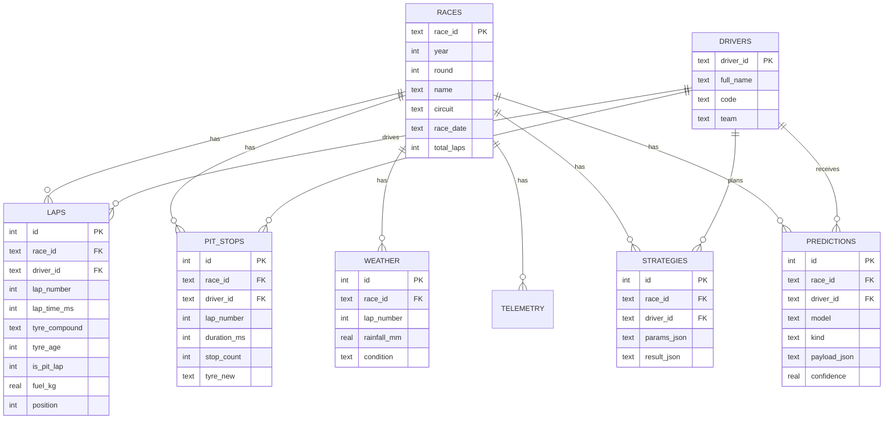

# Database

SQLite file `database/race.db` — schema in [`schema.sql`](../database/schema.sql).
PostgreSQL migration is deferred until needed (same logical schema).

## Entity-Relationship diagram

## Conventions

- All lap/sector times are **integer milliseconds**.
- `tyre_age` = laps completed on the current set (1 = out lap of a fresh set).
- `TELEMETRY` stores per-sample rows and grows fast; it is only populated by
  the FastF1 ingest path (the offline demo race has no telemetry).
- Python writes the race data (ingest); Spring Boot reads it and writes
  `STRATEGIES` (saved simulation results).
