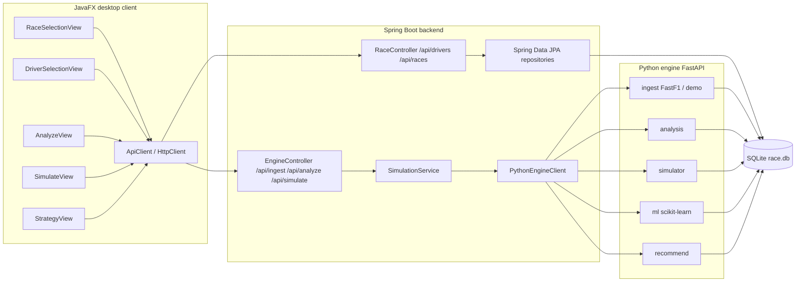

# UML

## Component diagram



## Key classes (sequence: "Simulate Race")

```mermaid
sequenceDiagram
    actor User
    participant FX as SimulateView (JavaFX)
    participant BE as EngineController (Spring)
    participant SS as SimulationService
    participant PY as Python /simulate
    participant DB as race.db

    User->>FX: choose compound + pit laps, click Simulate
    FX->>BE: POST /api/simulate
    BE->>SS: simulate(request)
    SS->>DB: read race context (via Python later; JPA for race rows)
    SS->>PY: POST /simulate {race_id, driver_id, pit_laps, ...}
    PY->>DB: SELECT laps, weather, pit_stops
    PY-->>SS: {finish_position, total_time_ms, timeline}
    SS->>DB: INSERT INTO strategies (params_json, result_json)
    SS-->>BE: result JSON
    BE-->>FX: result JSON
    FX-->>User: table + finish position + race time
```
